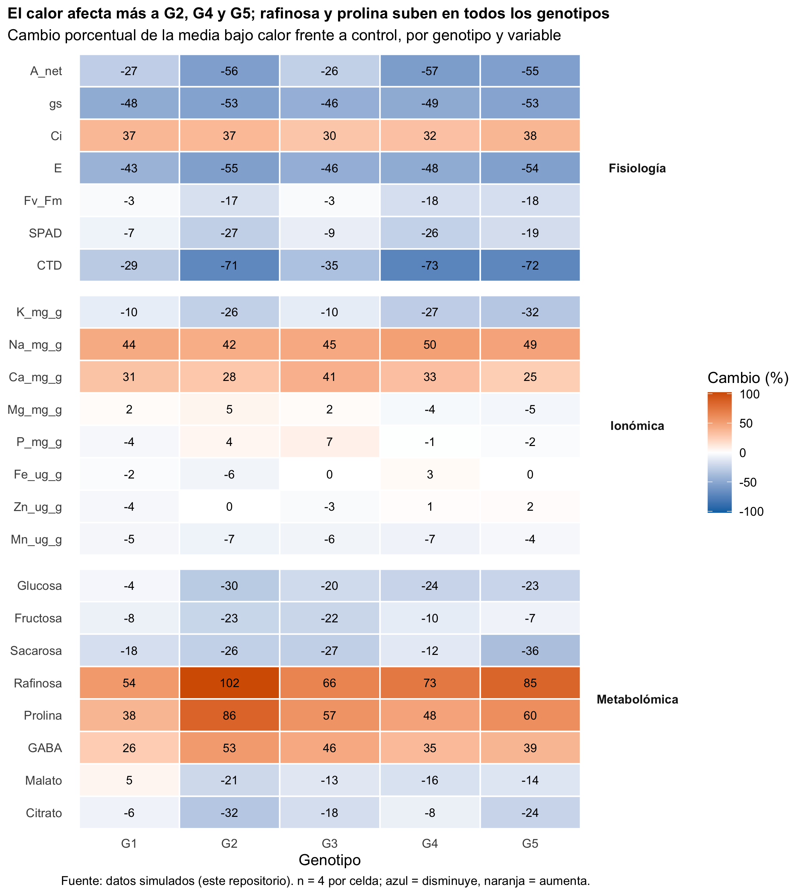
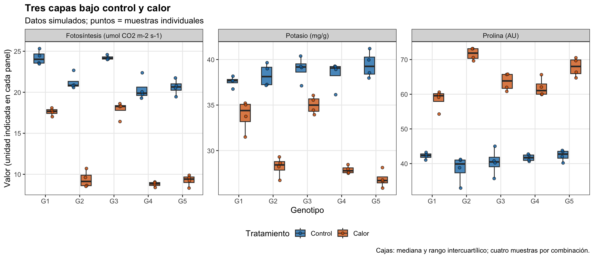

# Trigo duro bajo estrés térmico

> **Aviso:** todos los datos de este repositorio son **simulados**. Están inspirados en una tesis sobre la respuesta del trigo duro (*Triticum durum*) al calor durante antesis, pero no son mediciones reales ni resultados de tesis.

Proyecto final del curso. Explora cómo responden la fisiología, la ionómica y la metabolómica del trigo duro al calor, y si los genotipos responden de forma distinta.

📊 **Informe final:** <https://palp311.github.io/Trigo-estres-termico/> · [código fuente](index.qmd)

Anexos: [informe borrador](https://palp311.github.io/Trigo-estres-termico/reports/informe_borrador.html) ([código](reports/informe_borrador.qmd)) · exploración de Quarto en [HTML](https://palp311.github.io/Trigo-estres-termico/reports/exploracion_quarto.html), [PDF](reports/exploracion_quarto.pdf) y [Word](reports/exploracion_quarto.docx) ([código](reports/exploracion_quarto.qmd))

## Preguntas exploratorias

1. ¿Cómo cambian la fisiología, la ionómica y la metabolómica bajo calor frente a control?
2. ¿Responden igual los cinco genotipos, o algunos sostienen mejor su desempeño?
3. ¿Qué relación hay entre fotosíntesis, potasio y prolina dentro de cada tratamiento?

## Dataset

40 muestras: cinco genotipos (G1–G5), dos tratamientos (Control y Calor) y cuatro bloques. Las tres tablas comparten `sample_id`:

| Archivo | Contenido |
|---|---|
| `data/raw/physiology_simulated.csv` | Intercambio gaseoso, fluorescencia y rasgos foliares |
| `data/raw/ionomics_simulated.csv` | Macro y micronutrientes |
| `data/raw/metabolomics_simulated.csv` | Ocho metabolitos, abundancia relativa (unidades arbitrarias) |

## Cómo reproducir

1. Abre `Trigo-estres-termico.Rproj` en RStudio y restaura las dependencias fijadas en `renv.lock`:

   ```r
   renv::restore()
   ```

2. Ejecuta el análisis desde la consola de R (valida y integra las tres tablas en `data/processed/`, guarda los resúmenes en `tables/eda_*.csv` y las figuras en `figures/eda/`):

   ```r
   source("scripts/01_eda.R")
   ```

3. Renderiza los informes desde la terminal, en la raíz del proyecto (requiere Quarto; el PDF requiere además una instalación de LaTeX, por ejemplo TinyTeX). `_quarto.yml` indica qué archivos se renderizan y las salidas quedan junto a cada `.qmd`:

   ```bash
   quarto render
   ```

Versiones usadas (fijadas en `renv.lock`): R 4.6.1, Quarto 1.5.57, dplyr 1.2.1, tidyr 1.3.2, readr 2.2.0, ggplot2 4.0.3, here 1.0.2, knitr 1.52, rmarkdown 2.32, emmeans 2.0.4, multcompView 0.1-12.

## EDA

El análisis es descriptivo: resúmenes por tratamiento y genotipo, cambio porcentual frente a control y correlaciones de Spearman dentro de cada tratamiento. La interpretación está en `reports/eda_detallado.md`.

- **Validación:** `scripts/01_eda.R` comprueba cada variable contra `data/diccionario_datos.csv` (existencia, tipo, NA, duplicados de `sample_id`, niveles y rangos esperados) y escribe el resultado en [`reports/validacion.md`](reports/validacion.md). Los valores fuera de rango solo se reportan; los problemas estructurales detienen el script.
- **Mapa de calor:** `figures/eda/eda_mapa_calor_cambio.png` muestra el cambio porcentual Calor frente a Control por genotipo y variable (tabla en `tables/eda_cambio_genotipo.csv`).



## Figuras



*Bajo calor cae la fotosíntesis neta y el potasio, y sube la prolina; G1 y G3 sostienen mejor la fotosíntesis. n = 4 muestras por genotipo y tratamiento (datos simulados).*


*Relación exploratoria entre fisiología y metabolómica dentro de cada tratamiento (n = 20 por panel; la asociación no implica causalidad).*

## Diccionario de datos

Todas las variables (metadatos, fisiología, ionómica y metabolómica) están descritas, con unidad, tipo y rango esperado, en [`data/diccionario_datos.csv`](data/diccionario_datos.csv).

> **Nota sobre unidades:** al ser datos simulados, las unidades de fisiología (A_net, gs, Ci, E, Fv_Fm, SPAD, CTD) son las convencionales asumidas para este tipo de medidas, no unidades registradas en un instrumento real.

## Licencia

El texto y los datos simulados de este repositorio se publican bajo la licencia [Creative Commons Atribución 4.0 Internacional (CC BY 4.0)](https://creativecommons.org/licenses/by/4.0/). Más detalles en [`LICENSE.md`](LICENSE.md).

## Cómo citar

> López, P. (2026). *Trigo duro bajo estrés térmico: exploración de datos simulados*. https://github.com/Palp311/Trigo-estres-termico

## Estructura

```text
Trigo-estres-termico/
├── Trigo-estres-termico.Rproj
├── index.qmd                  # Informe final (portada del sitio)
├── _quarto.yml                # Proyecto Quarto (qué se renderiza)
├── renv.lock                  # Versiones de paquetes fijadas
├── renv/                      # Infraestructura de renv (la biblioteca no se versiona)
├── LICENSE.md                 # Licencia CC BY 4.0
├── data/
│   ├── raw/                   # Datos simulados originales (no se modifican)
│   ├── processed/             # Tablas generadas por el script
│   └── diccionario_datos.csv  # Diccionario de variables
├── bib/
│   ├── referencias_literatura.bib # Bibliografía del informe final
│   └── referencias_paquetes.bib   # Citas de paquetes (generada con knitr::write_bib())
├── tables/                    # Resúmenes del EDA (eda_*.csv)
├── figures/
│   ├── eda/                   # Figuras del script de EDA (PNG y PDF)
│   ├── final/                 # Figuras del informe final
│   └── quarto/                # Figuras de la exploración de Quarto
├── reports/                   # Informes (.qmd), interpretación y validación
│   └── actividades/           # Actividades semanales del curso
└── scripts/                   # Código en R
```
