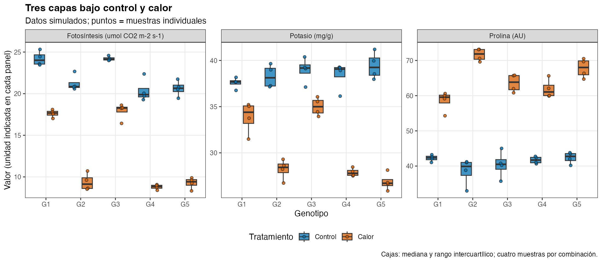
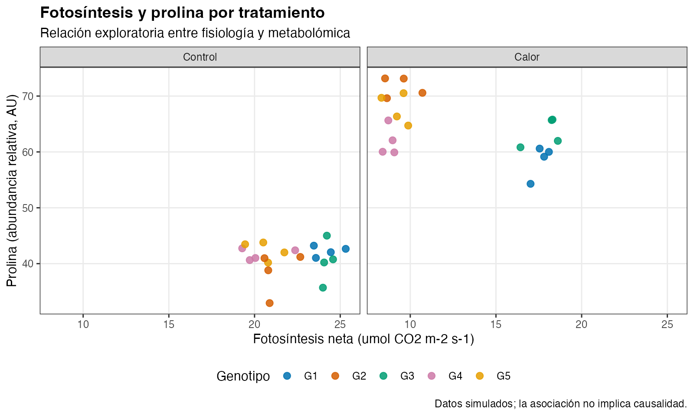

# Trigo duro bajo estrés térmico

> **Aviso:** todos los datos de este repositorio son **simulados**. Están inspirados en una tesis sobre la respuesta del trigo duro (*Triticum durum*) al calor durante antesis, pero no son mediciones reales ni resultados de tesis.

Proyecto final del curso. Explora cómo responden la fisiología, la ionómica y la metabolómica del trigo duro al calor, y si los genotipos responden de forma distinta.

## Preguntas exploratorias

1. ¿Cómo cambian la fisiología, la ionómica y la metabolómica bajo calor frente a control?
2. ¿Responden igual los cinco genotipos, o algunos sostienen mejor su desempeño?
3. ¿Qué relación hay entre fotosíntesis, potasio y prolina dentro de cada tratamiento?

## Dataset

40 muestras: cinco genotipos (G1–G5), dos tratamientos (Control y Calor) y cuatro bloques. Las tres tablas comparten `sample_id`:

| Archivo | Contenido |
|---|---|
| `data/raw/physiology_simulated.csv` | Intercambio gaseoso, fluorescencia y rasgos foliares |
| `data/raw/ionomics_simulated.csv` | Macro y micronutrientes |
| `data/raw/metabolomics_simulated.csv` | Ocho metabolitos, abundancia relativa (unidades arbitrarias) |

## Cómo reproducir

Abre `Proyecto_final_trigo.Rproj` y ejecuta desde la raíz:

```r
source("scripts/01_eda.R")
```

El script valida que las tres tablas coincidan, las integra en `data/processed/` y guarda los resúmenes en `reports/eda_*.csv` y las figuras en `figures/`.

Versiones usadas: R 4.6.1, dplyr 1.2.1, tidyr 1.3.2, readr 2.2.0, ggplot2 4.0.3.

## EDA

El análisis es descriptivo: resúmenes por tratamiento y genotipo, cambio porcentual frente a control y correlaciones de Spearman dentro de cada tratamiento. La interpretación está en `reports/eda_detallado.md`.

## Figuras



*Bajo calor cae la fotosíntesis neta y el potasio, y sube la prolina; G1 y G3 sostienen mejor la fotosíntesis. n = 4 muestras por genotipo y tratamiento (datos simulados).*



*Relación exploratoria entre fisiología y metabolómica dentro de cada tratamiento (n = 20 por panel; la asociación no implica causalidad).*

## Estructura

```text
Trigo-estres-termico/
├── Proyecto_final_trigo.Rproj
├── data/
│   ├── raw/          # Datos simulados originales (no se modifican)
│   └── processed/    # Tablas generadas por el script
├── figures/          # Figuras del EDA
├── reports/          # Resúmenes, interpretación y actividades semanales
└── scripts/          # Código en R
```
